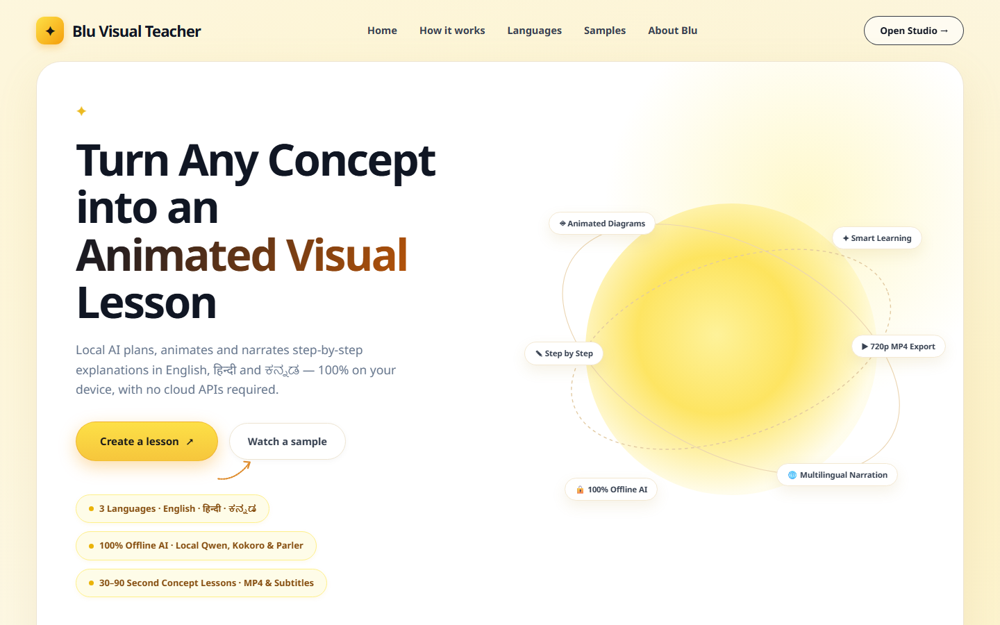
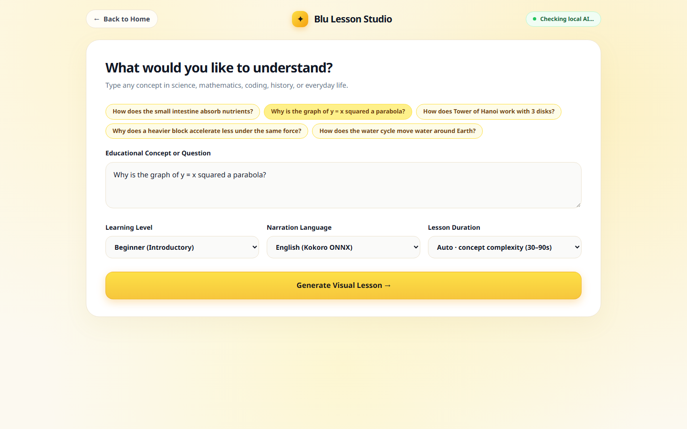
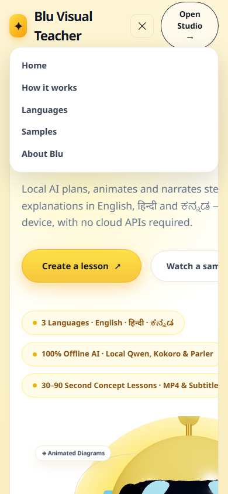
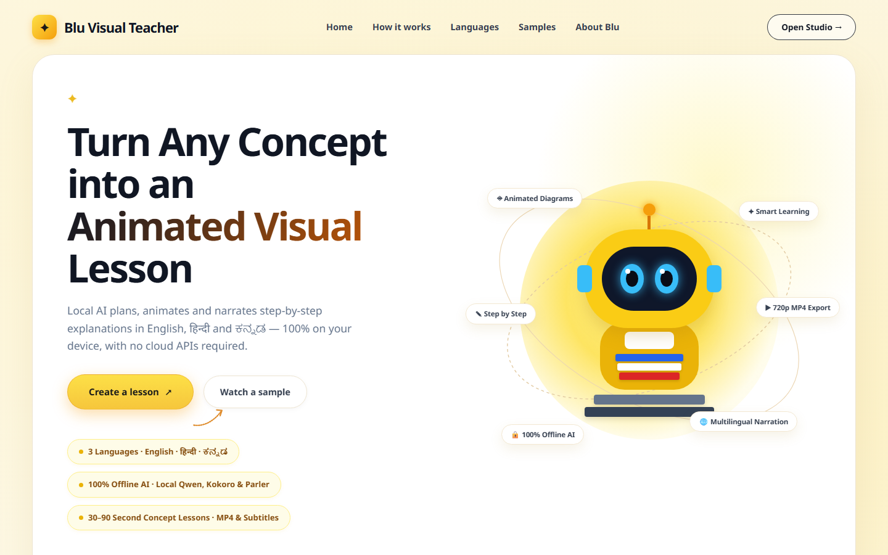

# Blu Visual Teacher

**Team:** V-MAX
**Platform:** Windows 11 (tested on Intel Core i7 12th Gen, NVIDIA RTX 3050 Laptop GPU 4 GB VRAM, 16 GB RAM)
**Repository:** [https://github.com/iitdsiddhant18-blip/v-max.git](https://github.com/iitdsiddhant18-blip/v-max.git)

---

## 1. Problem Statement

High-quality STEM and conceptual education is hindered across diverse linguistic populations by three major barriers:
1. **Language Disparity:** Rich visual educational materials are overwhelmingly English-first. Indic translations often corrupt code snippets, mathematical notation, and domain-specific terminology.
2. **Audio-Visual Desynchronization:** Auto-translated video lessons frequently experience pacing mismatch, where speech drifts away from the on-screen visual diagrams.
3. **Cloud Dependency & Resource Demands:** Many generative AI solutions rely on costly proprietary cloud APIs, high-bandwidth internet connectivity, or massive datacenter GPUs, making them inaccessible in bandwidth-constrained, offline classrooms.

**Blu Visual Teacher** solves these challenges by providing an entirely local, offline AI educational platform that transforms any topic prompt into an interactive, speech-synchronized, multilingual animated lesson and broadcast-ready 720p video in **English**, **Hindi**, and **Kannada**.

---

## 2. Actual Implemented Capabilities

- **Topic-Neutral Educational Planning:** Generates structured teaching lessons (title card, pedagogical core scenes, summary card) with explicit learning facts, domain entities, and step-by-step causal mechanisms.
- **Auto-Complexity Duration (30–90s):** Dynamically calculates pedagogical complexity (prerequisites, causal steps, formal mathematical reasoning, and worked examples) to assign a realistic 30–90 second lesson budget, with manual 30s/60s/90s overrides available.
- **Typed Semantic Visual Sidecar:** Renders deterministic, speech-synchronized SVG and 2D canvas visual elements:
  - Relationship maps & concept graphs
  - Flow processes & cyclical diagrams
  - Labeled anatomical/physical illustrations (lungs, small intestine, plant cell, mitochondria)
  - Numeric function plots ($y = x^2$ parabola), coordinate grids, and number lines
  - Physical force vectors, circuit schematics, and wave diagrams
  - Bounded algorithm/code execution traces (Tower of Hanoi, loops, recursion)
  - Timelines and multi-column comparative tables
- **Protected Multilingual Translation:**
  - Local offline IndicTrans2 (`ai4bharat/indictrans2-en-indic-dist-200M`) translates lesson text into Hindi (`hin_Deva`) and Kannada (`kan_Knda`).
  - Strict token protection preserves programming keywords, math functions (`sin`, `cos`, `log`), units (`kg`, `m/s`), variables, and chemical formulas from corruptive transliteration.
- **Acoustic Synchronization & Subtitles:**
  - Synthesizes speech using Kokoro ONNX (English `hm_omega`, Hindi `hf_alpha`) and Indic Parler-TTS (Kannada).
  - Measures raw PCM wave chunks to establish exact audio boundaries for every teaching beat.
  - Automatically exports standards-compliant UTF-8 `.srt` subtitle files with millisecond accuracy.
- **Headless Video Export:**
  - Playwright and FFmpeg render and encode 720p H.264/AAC MP4 videos at 30 fps with burned-in subtitles and synchronized animations.
- **Interactive Web Experience:**
  - Reference-inspired warm cream landing design (`#fcf9f0`).
  - Interactive 3D robot mascot (`RobotMascot.tsx`) rendered with React Three Fiber / Three.js featuring hero-wide cursor head-tracking, smooth delta damping, and automatic WebGL fallback.
  - Dedicated **Lesson Studio** (`/studio`) for prompt authoring, parameter tuning, live interactive preview, audio playback, and one-click media export.
  - Pure video-rendering routes (`/render`, `/render-lesson`, `/render-localized`, `/lesson`) completely isolated from 3D canvas and marketing elements.

---

## 3. Architecture

```text
               +----------------------------------------------------+
               |                User / Web Browser                  |
               |   Landing Page (3D Mascot)  /  Studio Page (/studio) |
               +-------------------------+--------------------------+
                                         | HTTP / REST
                                         v
               +----------------------------------------------------+
               |          FastAPI Backend (Uvicorn :8000)           |
               +----+--------------------+---------------------+----+
                    |                    |                     |
     [Lesson Generation]        [Translation]          [Speech Synthesis]
            v                            v                     v
   +-----------------+         +-------------------+  +------------------+
   |  Local Ollama   |         | IndicTrans2 200M  |  | Kokoro ONNX (EN) |
   |  llama3.2:3b    |         | (hi: hin_Deva     |  | Kokoro ONNX (HI) |
   |  (qwen3:4b fallback)      |  kn: kan_Knda)    |  | Parler-TTS (KN)  |
   +--------+--------+         +---------+---------+  +--------+---------+
            |                            |                     |
            +--------------------+-------+---------------------+
                                 |
                                 v
               +----------------------------------------------------+
               |           Timeline & Cache Synchronization          |
               |  - Strict 30-90s Duration Validation               |
               |  - SHA-256 Lesson ID Cryptographic Binding         |
               |  - Exact Audio-Aligned Visual Cue Timestamps       |
               +-------------------------+--------------------------+
                                         |
                        +----------------+----------------+
                        |                                 |
                        v                                 v
        +-------------------------------+   +-----------------------------+
        |   Interactive React Player    |   |     Headless Video Render   |
        | - HTML5 Canvas & Typed SVG    |   | - Playwright Chromium       |
        | - Web Audio API Playback      |   | - FFmpeg H.264 / AAC 720p   |
        | - Multilingual Script Switch  |   | - Burned-in Captions & SRT  |
        +-------------------------------+   +-----------------------------+
```

---

## 4. Technology Stack

| Layer | Technologies |
|---|---|
| **Backend Core** | Python 3.11, FastAPI, Uvicorn, Pydantic v2, Pytest |
| **LLM Inference** | Local Ollama (`llama3.2:3b` primary planner, `qwen3:4b` critic/fallback) |
| **Translation** | Hugging Face Transformers, IndicTrans2 (`ai4bharat/indictrans2-en-indic-dist-200M`), IndicTransToolkit |
| **Speech (EN / HI)** | Kokoro ONNX (`kokoro-v0_19.onnx`, voices: `hm_omega`, `hf_alpha`), SoundFile, NumPy |
| **Speech (KN)** | Indic Parler-TTS (`ai4bharat/indic-parler-tts`) via isolated Python worker |
| **Video & Media** | FFmpeg (h264_nvenc / libx264), ffprobe, Playwright Chromium headless |
| **Frontend Framework** | React 19, TypeScript, Vite 8 |
| **3D & Graphics** | Three.js, React Three Fiber (`@react-three/fiber`), HTML5 Canvas, SVG |
| **Typography & Fonts** | Bundled Noto Sans (Latin, Devanagari, Kannada) for 100% offline text shaping |

---

## 5. Visual Showcase

| Landing Page (1440×900) | Interactive Lesson Studio (`/studio`) |
|---|---|
|  |  |

| Responsive Mobile View (390×844) | WebGL-Disabled Fallback Robot |
|---|---|
|  |  |

---

## 6. Setup & Installation Requirements

### Prerequisites
- **Operating System:** Windows 10/11 64-bit
- **Shell:** Windows PowerShell 5.1 or PowerShell 7
- **Node.js:** Node 18+ (tested on Node 24.14.1)
- **Python:** Python 3.11 64-bit (recommended: Python 3.11.4)
- **FFmpeg:** FFmpeg and ffprobe available in system `PATH`
- **Ollama:** Installed locally on `http://127.0.0.1:11434`
- **Hardware Recommended:** NVIDIA GPU with $\ge 4\text{ GB}$ VRAM (e.g. RTX 3050 Laptop GPU) and $\ge 16\text{ GB}$ system RAM.

### 1. Local Models Installation
Pull the required Ollama models:
```powershell
ollama pull llama3.2:3b
ollama pull qwen3:4b
```

Place the offline translation and TTS model checkpoints in their designated local directories:
- `models/indictrans2-en-indic-dist-200M/` (IndicTrans2 Hugging Face weights)
- `models/kokoro-v0_19.onnx` and `models/voices.bin` (Kokoro ONNX voice models)
- Local Hugging Face cache for `ai4bharat/indic-parler-tts`

### 2. Python Virtual Environments
Blu uses two isolated Python environments to prevent CUDA/dependency collisions between ONNX and Parler-TTS:

```powershell
# 1. Main backend environment (FastAPI, IndicTrans2, Kokoro ONNX)
python -m venv .venv
.\.venv\Scripts\Activate.ps1
pip install -r backend/requirements.txt

# 2. Kannada TTS isolated environment (Indic Parler-TTS)
python -m venv .venv-tts
.\.venv-tts\Scripts\Activate.ps1
pip install torch torchaudio transformers parler-tts
```

### 3. Frontend Setup
```powershell
Push-Location frontend
npm install
Pop-Location
```

---

## 7. Running the Application

Open two separate Windows PowerShell windows from `C:\blu`:

### Terminal 1: Backend API
```powershell
.\.venv\Scripts\python.exe -m uvicorn backend.app.main:app --host 127.0.0.1 --port 8000
```
API documentation is available at `http://127.0.0.1:8000/docs`.

### Terminal 2: Frontend Client
```powershell
Push-Location frontend
npm run dev
```
Open your browser to `http://127.0.0.1:5173`.

---

## 8. Step-by-Step Usage Guide

### Creating a Lesson
1. Visit `http://127.0.0.1:5173`. Enjoy the interactive 3D robot mascot tracking your cursor.
2. Click **Create a lesson** or navigate to `/studio`.
3. In the Lesson Studio:
   - Enter your educational topic (e.g., *"Why is the graph of y = x squared a parabola?"* or *"How does Tower of Hanoi work with 3 disks?"*).
   - Select difficulty: **Introductory** (beginner) or **In-depth** (intermediate).
   - Choose language: **English**, **हिन्दी**, or **ಕನ್ನಡ**.
   - Select duration: **Auto (Complexity-driven)** (30–90s) or manual (`30s`, `60s`, `90s`).
4. Click **Create lesson**. The backend plans the pedagogy, evaluates complexity, synthesizes voice, computes cues, and renders the interactive player.

### Interacting with the Player
- **Play / Pause:** Play synchronized speech audio with live diagram highlighting.
- **Scrubbing:** Drag the progress bar or jump between scenes using the scene navigation pills.
- **Language Switch:** Seamlessly switch between English, Hindi, and Kannada for the same concept without replanning.
- **SRT Download:** Click **Download Subtitles (.srt)** to export millisecond-aligned UTF-8 subtitles.
- **MP4 Export:** Click **Export 720p Video** to trigger headless video encoding.

---

## 9. Verification & Testing

### Running the Python Backend Tests
Execute the complete test suite:
```powershell
.\.venv\Scripts\python.exe -m pytest backend/tests -q
```
**Current Status:** `215 passed in ~14s` (0 failures, 0 errors).

Key test modules include:
- `backend/tests/test_translation_contract.py`: Multi-scene Indic translation, token shielding, and script validation.
- `backend/tests/test_auto_duration.py`: Pedagogical complexity rubric and 30–90s duration enforcement.
- `backend/tests/test_visual_schema.py`: Visual DSL contracts, anchor grounding, and AST schemas.
- `backend/tests/test_final_gate.py`: Cache tamper-resistance, duration boundaries, and API error recovery.
- `backend/tests/test_live.py`: Audio chunking, PCM alignment, and full lesson assembly.

### Building the Frontend Production Bundle
```powershell
Push-Location frontend
npm run build
Pop-Location
```
**Current Status:** Built in $\approx 500\text{ ms}$ with 0 TypeScript or bundling errors.

### Automated End-to-End Media Verification
To inspect pre-generated 3-language lessons and MP4 video files without re-synthesizing:
```powershell
.\.venv\Scripts\python.exe -m backend.scripts.final_demo_check `
  --english-id 6287dd193602b6ca47fae74b0fbac7cba5a875c0c32cfa1f40a3d8cc50f22103 `
  --hindi-id 6aec256136cd591600b7882597b575d12269e618505563f06537f8e5a120c6f3 `
  --kannada-id c92638bebb65c8f2bdace7a95312464e7461f8a1d27438d7d4bdab65ba8f77f2
```

---

## 10. Truthful Offline & Operational Disclosures

To maintain strict academic and professional integrity, we explicitly document all operational boundaries and verification states:

| Dimension | Real Verified State | Disclosure & Caveat |
|---|---|---|
| **Generalization Scope** | **8 topics live-verified with Ollama; 22 topics verified at component/fixture level** | The engine does not guarantee bespoke or flawless visual representations for every arbitrary prompt. Unfamiliar concepts default to truthful relationship diagrams or structured fallbacks. |
| **Duration Compliance** | **Strict 30.00s – 90.00s bounds enforced programmatically** | Any generated lesson whose synthesized audio falls outside 30.00s–90.00s is automatically rejected prior to cache publication or export. |
| **Offline Operation** | **Software-verified offline** | All API routes, models, fonts, and scripts execute locally with zero external network calls. Physical Wi-Fi disconnect testing remains an operator verification step. |
| **Linguistic Quality** | **Algorithmic translation & phoneme alignment verified** | Hindi and Kannada translations are generated by IndicTrans2 and synthesized via neural TTS. Native human linguistic and cultural sign-off remains pending. |
| **Hardware & GPU Lifecycle** | **Sequential GPU memory lifecycle required on 4 GB VRAM** | Running Ollama, IndicTrans2, and Parler-TTS concurrently will exceed 4 GB VRAM. The system explicitly unloads Ollama before translation and speech synthesis. On CPU-only systems, generation latency will be significantly higher. |

---

## 11. Licenses & Attributions

All open-source models, libraries, and fonts used in Blu Visual Teacher are compliant with their respective upstream licenses:
- **Kokoro-82M / Kokoro ONNX:** Apache 2.0
- **IndicTrans2 / IndicTransToolkit:** MIT / CC-BY-4.0 (AI4Bharat)
- **Indic Parler-TTS:** Apache 2.0 (AI4Bharat / Hugging Face)
- **Ollama / LLaMA 3.2 3B:** Meta Llama 3.2 Community License / MIT
- **Qwen 2.5 / Qwen 3:** Apache 2.0
- **Noto Sans Fonts (Latin, Devanagari, Kannada):** SIL Open Font License 1.1
- **Three.js & React Three Fiber:** MIT License

Detailed licensing documentation and upstream notices are compiled in [docs/LICENSES.md](docs/LICENSES.md).

---

## 12. Project Documentation Directory

- [Demo Runbook](docs/DEMO_RUNBOOK.md): Complete step-by-step judge demonstration guide.
- [Visual DSL Specification](docs/VISUAL_DSL.md): Schema and layout contracts for the typed visual engine.
- [Phase 4 Verification Report](docs/PHASE_4_VERIFICATION_REPORT.md): Authoritative Phase 4 backend and generalization test results.
- [Frontend Verification Report](docs/FRONTEND_FINAL_VERIFICATION_REPORT.md): Visual design, 3D mascot, and responsive layout verification.
- [Frontend QA & Acceptance](docs/FRONTEND_QA.md): Playwright test evidence and viewport matrix.
- [Generalization Matrix & QA](docs/GENERALIZATION_QA.md): 30-topic empirical evaluation across biology, math, physics, and computer science.
- [License Audit](docs/LICENSES.md): Full compliance and attribution ledger.
